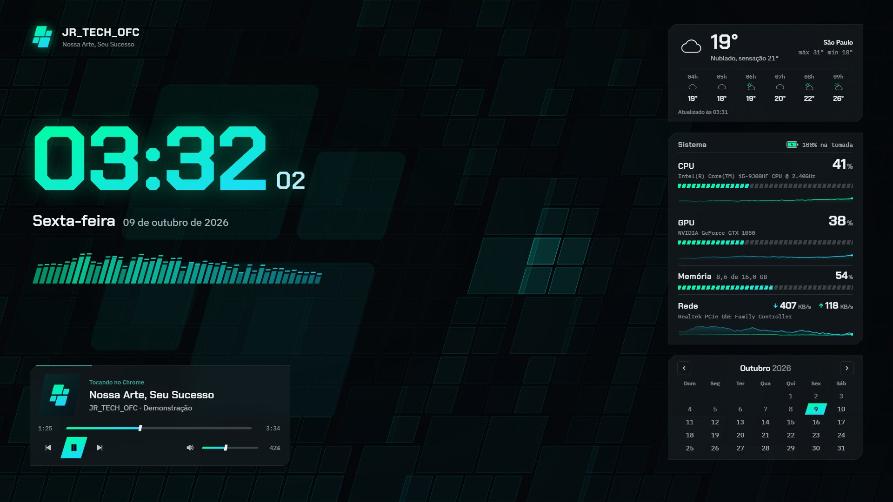
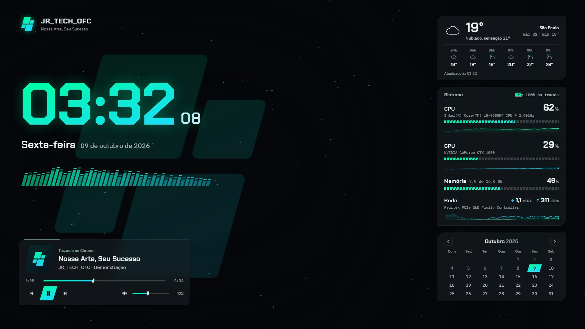
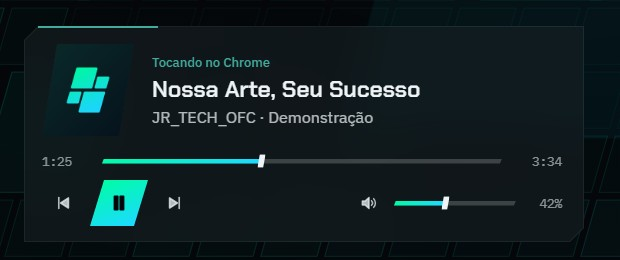
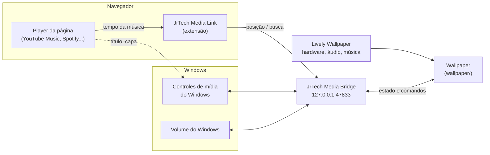

<div align="center">


# JR_TECH_OFC Dashboard

**Wallpaper interativo para o Lively Wallpaper, feito com a identidade da marca Jr_Tech_OFC.**<br>
Relógio, clima, sistema, calendário e um player de música completo, sobre uma malha no formato do logo que reage ao mouse e à música.




</div>

## Destaques

- **Identidade de verdade.** O paralelogramo inclinado do logo (16°) aparece nas barras, no visualizador, no calendário, nas capas e no fundo. As cores são as do próprio logo.
- **Player de música completo.** Tocar, pausar, passar, voltar, barra de progresso que dá para arrastar e volume do Windows. Funciona com Firefox, Chrome, Edge, Spotify e qualquer player que apareça nos controles de mídia do Windows.
- **Fundo que reage.** A malha acende perto do cursor e solta uma onda no clique. Com música, cada batida dispara uma onda a partir do logo gigante e um equalizador sobe pelas peças. No modo partículas, elas tremem na batida e o logo vibra como a membrana de um alto-falante.
- **Dados reais, nunca inventados.** CPU, GPU, memória e rede vêm do Lively, o clima do Open-Meteo e a bateria do Windows. Se algum dado não chega, aparece `n/d`. Fora do Lively, um selo avisa que os dados são simulados.
- **Leve.** Um único loop de animação (cerca de 1 ms por quadro em 1080p) que pausa sozinho quando um app está em tela cheia.
- **Tudo é módulo.** Cada parte liga e desliga no painel do Lively.

<table>
  <tr>
    <td width="50%"><br><sub><b>Modo partículas:</b> tremem e são empurradas na batida</sub></td>
    <td width="50%"><br><sub><b>Tela de bloqueio:</b> combina com o wallpaper e respeita as áreas do Windows</sub></td>
  </tr>
</table>

<div align="center">
  <br>
  <sub>Player com capa, barra de progresso arrastável, controles e volume do Windows</sub>
</div>

## Instalação

Os pacotes prontos ficam na página de **[Releases](../../releases/latest)**.

**1. Wallpaper.** Baixe `JrTech-Wallpaper-Lively.zip` e arraste o arquivo para a biblioteca do Lively. No painel do wallpaper, preencha **Clima > Cidade**. Para a malha reagir ao cursor, ative **Configurações do Lively > Wallpaper > Entrada: Mouse**.

**2. Controles de música** (opcional). Rode `media-bridge/instalar.cmd`. Ele instala o JrTech Media Bridge para iniciar com o Windows, sem janela. Para remover, use `desinstalar.cmd`.

**3. Barra de progresso no navegador** (opcional). Só é necessária quando o navegador não informa o tempo da música ao Windows, como no Firefox com o YouTube Music.

| Navegador | Como instalar |
|---|---|
| Firefox (Nightly ou Developer Edition) | Em `about:config`, mude `xpinstall.signatures.required` para `false`. Depois, em `about:addons` > engrenagem > *Instalar extensão de arquivo*, escolha `JrTechMediaLink-firefox.xpi` (da Release). |
| Chrome ou Edge | Em `chrome://extensions` (ou `edge://extensions`), ative o *Modo do desenvolvedor*, clique em *Carregar sem compactação* e escolha a pasta `browser-extension/`. |

Depois de instalar, recarregue a aba do player.

**4. Tela de bloqueio** (opcional). Vá em Configurações do Windows > Personalização > Tela de bloqueio > *Imagem* e escolha `lock-screen/tela-de-bloqueio-1920x1080.png`.

## Como funciona



- **Lively** entrega ao wallpaper os dados de hardware, o espectro do áudio e a música atual (ativados em `LivelyInfo.json`).
- O **JrTech Media Bridge** é um servidor local (só `127.0.0.1`, em PowerShell, sem instalar nada) que usa os Controles de Mídia e o volume do Windows. É por ele que os botões do player funcionam.
- O **JrTech Media Link** lê o tempo direto do player da página e aplica as buscas feitas no wallpaper. Ele cobre os navegadores que não passam esse dado ao Windows.

## Estrutura

```
├── wallpaper/            O wallpaper (exatamente o que vai no zip do Lively)
│   ├── index.html
│   ├── LivelyInfo.json         metadados e argumentos do Lively
│   ├── LivelyProperties.json   opções do painel do Lively
│   ├── css/                    tokens da marca, layout, módulos
│   ├── js/core.js              configuração, loop único, escala, batida
│   ├── js/lively-bridge.js     API do Lively + modo prévia
│   ├── js/modules/             relógio, calendário, sistema, clima, player, áudio, fundo
│   └── fonts/                  Chakra Petch e IBM Plex (locais, funcionam offline)
├── media-bridge/         Servidor local de controles de música e volume
├── browser-extension/    Extensão do navegador (Chrome/Edge carregam a pasta direto)
├── lock-screen/          Imagem da tela de bloqueio e o HTML que a gera
├── docs/                 Imagens deste README
└── build.ps1             Gera os pacotes em dist/
```

## Opções no painel do Lively

| Grupo | Opções |
|---|---|
| Módulos | Logo, relógio, visualizador de áudio, música, clima, sistema e calendário (cada um liga e desliga) |
| Relógio | Formato 24 horas, mostrar segundos |
| Clima | Cidade, Celsius ou Fahrenheit |
| Fundo | Malha da marca, partículas ou liso; tamanho das peças |
| Aparência | Cor primária e secundária, brilho, opacidade dos painéis, escala da interface, limite de FPS |
| Disco | Usado e total em GB, preenchidos à mão (o Lively não informa disco) |

## Desenvolvimento

O projeto não tem build: é HTML, CSS e JavaScript puro.

- **Prévia:** abra `wallpaper/index.html` no navegador. Sem o Lively entra o modo prévia, com dados simulados e um selo avisando isso.
- **Pacotes:** `powershell -ExecutionPolicy Bypass -File build.ps1` gera em `dist/` o `JrTech-Wallpaper-Lively.zip` e o `JrTechMediaLink-firefox.xpi`.
- **Testar no Lively:** copie `wallpaper/` para a pasta do wallpaper na biblioteca do Lively e reinicie o app.

## Solução de problemas

| Sintoma | Causa e solução |
|---|---|
| O Lively diz "Arquivo não compatível" | O `LivelyInfo.json` precisa estar na **raiz** do zip. Use o zip da Release ou o `build.ps1`, e não compacte a pasta pelo botão direito. |
| Hardware, música ou áudio não aparecem | Remova o wallpaper e importe o zip de novo; os argumentos do `LivelyInfo.json` só são lidos na importação. |
| O player mostra a música, mas sem botões | O Media Bridge não está rodando. Rode `media-bridge/instalar.cmd`. |
| A barra de progresso não aparece | O navegador não informa o tempo ao Windows. Instale a extensão (passo 3). |
| A malha não reage ao mouse | Ative *Entrada: Mouse* nas configurações do Lively. |

## Créditos

- Fontes [Chakra Petch](https://fonts.google.com/specimen/Chakra+Petch) e [IBM Plex](https://www.ibm.com/plex/), sob a SIL Open Font License.
- Clima: [Open-Meteo](https://open-meteo.com/), gratuito e sem chave.
- Feito para o [Lively Wallpaper](https://github.com/rocksdanister/lively).

<div align="center">
<sub>© Jr_Tech_OFC. Nossa Arte, Seu Sucesso. Todos os direitos reservados.</sub>
</div>
