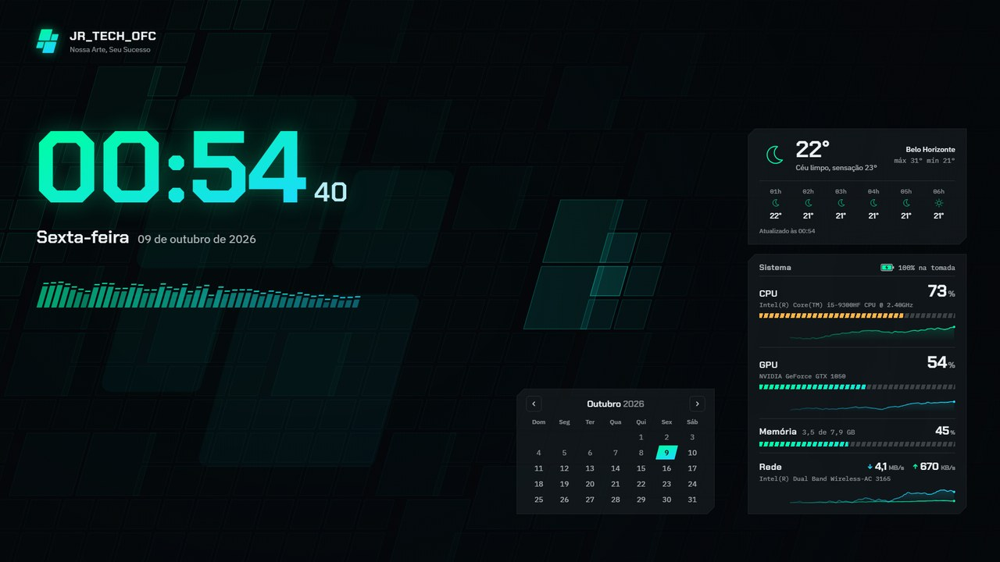

# JR_TECH_OFC Dashboard

Wallpaper interativo da marca Jr_Tech_OFC para o [Lively Wallpaper](https://www.rocksdanister.com/lively/):
relógio, calendário, clima, monitor do sistema, player de música com controles e
visualizador de áudio, sobre uma malha no formato do logo que reage ao mouse e à música.

## O que tem aqui

| Pasta / arquivo | O que é |
|---|---|
| `index.html`, `css/`, `js/`, `fonts/` | O wallpaper (HTML/CSS/JS puro, sem build) |
| `LivelyInfo.json` | Metadados e argumentos do Lively (hardware, áudio, música, pausa) |
| `LivelyProperties.json` | Opções do painel do Lively (módulos, cores, clima, fundo...) |
| `helper/` | **JrTech Media Bridge**: servidor local que controla a música e o volume do Windows |
| `extension/` | **JrTech Media Link**: extensão do navegador que passa o tempo da música (barra de progresso) |
| `lockscreen/` | Imagem da tela de bloqueio e o HTML que a gera |

## Instalação

### 1. Wallpaper
Crie um `.zip` com o **conteúdo** da pasta (o `LivelyInfo.json` precisa ficar na raiz do zip,
não dentro de uma subpasta) e arraste o zip para a biblioteca do Lively.

Depois, no painel do wallpaper:
- **Clima > Cidade**: digite sua cidade.
- Em Configurações do Lively > Wallpaper > Entrada: **Mouse**, para a malha reagir ao cursor.

### 2. Controles de música (JrTech Media Bridge)
Rode `helper/instalar.cmd`. Ele copia o Bridge para `%LOCALAPPDATA%\JrTechMediaBridge`,
coloca na inicialização do Windows (sem janela) e já inicia.
Para remover: `helper/desinstalar.cmd`.

O Bridge escuta só em `127.0.0.1:47833` e usa os Controles de Mídia do Windows
(os mesmos das teclas de mídia), então funciona com Firefox, Chrome, Edge, Spotify etc.

### 3. Barra de progresso no navegador (JrTech Media Link)
Necessária quando o navegador não passa o tempo da música ao Windows (ex.: Firefox + YouTube Music).

- **Firefox (Nightly/Developer Edition):** em `about:config`, deixe `xpinstall.signatures.required = false`.
  Depois, em `about:addons` > engrenagem > *Instalar extensão de arquivo*, escolha
  `extension/dist/JrTechMediaLink-firefox.xpi`.
- **Chrome / Edge:** em `chrome://extensions` (ou `edge://extensions`), ative o *Modo do desenvolvedor*,
  clique em *Carregar sem compactação* e escolha `extension/dist/JrTechMediaLink-chrome-edge`.

Recarregue a aba do player depois de instalar.

### 4. Tela de bloqueio
Configurações do Windows > Personalização > Tela de bloqueio > *Imagem* > *Procurar fotos* >
`lockscreen/tela-de-bloqueio-1920x1080.png`.

## Desenvolvimento
Abra `index.html` direto no navegador: sem o Lively entra o **modo prévia**, com dados simulados
e um selo avisando isso. Para aplicar mudanças no Lively instalado, copie os arquivos para a pasta
do wallpaper na biblioteca do Lively e reinicie o app.
